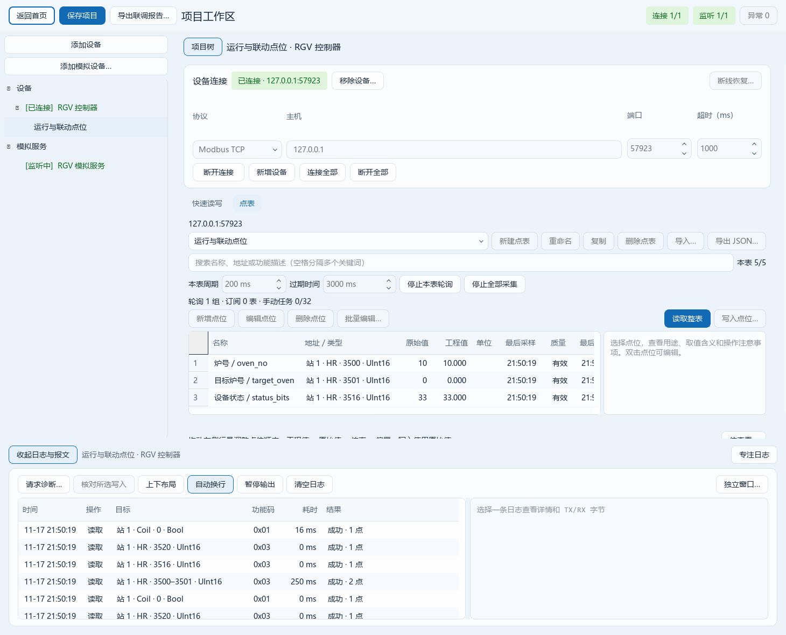
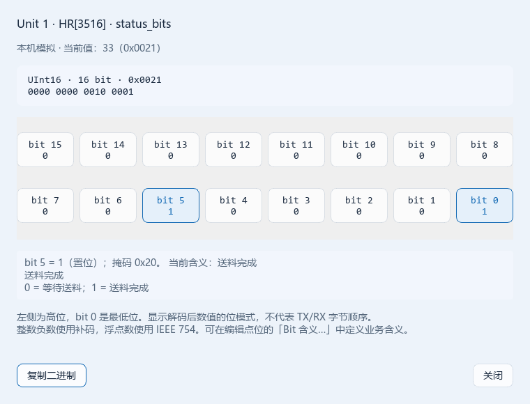
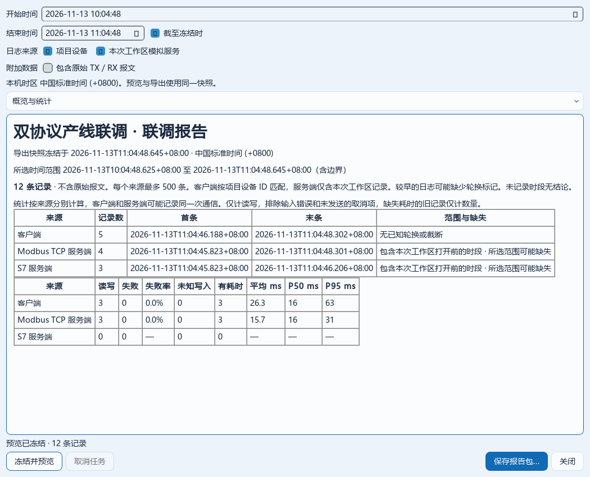

# AllProtocol · 工业协议调试台

[](https://github.com/GTboy04/all-protocol/stargazers)
[](LICENSE)
[](pyproject.toml)


面向 PLC 和工业设备联调的 Windows 桌面工具。通过同一个工作区连接真实设备、启动多台模拟设备、监视点位并查看原始报文。支持 **Modbus TCP** 和 **Siemens S7（经典 S7comm / ISO-on-TCP）** 客户端与服务端，以及 **Modbus RTU** 和 **OPC UA** 预览版。设备、点表、逐位业务含义和模拟方案可随项目保存，便于重复联调。

Modbus RTU 已提供串口客户端与多站模拟服务，实机串口验收待完成；OPC UA 已提供端点发现、节点浏览、安全读写、订阅和本机模拟服务，独立厂商设备验收待完成。断线恢复的软件功能已实现，现场与连续 24 小时稳定性验收仍待完成。详见 [RTU](docs/r11-modbus-rtu.md)、[OPC UA](docs/r12-opc-ua.md) 和[运行恢复交付记录](docs/r13-runtime-reliability.md)。

[功能概览](#功能概览) · [多设备模拟](#多设备模拟) · [点位描述与 Bit 含义](#点位描述与-bit-含义) · [快速开始](#快速开始) · [本机联调](#本机联调) · [使用指南](docs/user-guide.md) · [Star 趋势](#star-趋势)



截图拍摄于 2026-11-13，使用本机模拟服务和示例数据；后续新增功能以正文和使用指南为准。

## 功能概览

| 能力 | 支持范围 |
| --- | --- |
| Modbus TCP | 按 Unit ID 访问 HR、IR、Coil 和 DI。支持 16、32、64 位寄存器类型及多种字节序和字序 |
| Modbus RTU（预览） | Windows COM 串口、9600 / 8E1 默认参数、站号 1–247；支持客户端读写及多站模拟服务、点表、回读与 CRC 诊断 |
| OPC UA（预览） | opc.tcp 端点发现、按层浏览、标量读写及回读、点表轮询和数据变更订阅；Basic256Sha256 / SignAndEncrypt、指定服务端证书信任及本机模拟服务 |
| Siemens S7 | 访问 DB、M、I、Q 区，支持 Bool、Byte、Int、Word、DInt、DWord 和 Real。I 区对网络客户端只读 |
| SQLite 存储 | 本地连接、服务端方案和日志统一入库；项目保存为可携带的 `.allprotocol` 数据库，兼容读取旧 JSON 项目 |
| 多设备与点表 | 每台设备独立会话，支持批量连接、命名点表、多组周期轮询、工程值换算及 JSON / CSV 导入 |
| 点位功能定义 | 多行用途、取值含义和注意事项；按名称、地址、描述筛选，跨当前设备点表定位；描述随项目及报告保存 |
| 断线恢复 | 默认关闭的设备级自动重连，有间隔与次数上限；可选恢复读取轮询/订阅，未知写入及排队手动请求不重放 |
| 调度与采样质量 | 手动请求与轮询公平排队；区分有效、超时、断开、协议失败和过期，失败保留最后成功值并标记旧数据 |
| 服务端场景 | 多协议可同时监听。点位支持固定值、递增、心跳、斜坡、正弦和时间轴，可暂停、重置或手动接管 |
| 多设备模拟 | 同一项目最多配置 64 个模拟服务，支持同协议多实例、复制与独立启停；各实例点位、场景、运行值和日志独立 |
| 点位排序 | 客户端点表和各协议模拟端支持停止采集或服务后拖动行号排序；Modbus TCP/RTU、S7 服务端还可按地址升序或降序查看 |
| Modbus 从站复用 | 按源 Unit ID 复制全部点位及场景规则到新从站；支持当前从站全部数据区点位的 JSON / CSV 导入导出 |
| 项目与报文 | 保存设备、点表和服务端方案到可移植的项目文件，联调时查看请求结果及 TX / RX 十六进制报文 |
| 日志阅读 | 可拖动列表与报文分隔条、切换上下 / 左右布局和自动换行；支持专注日志及可最大化的独立窗口 |
| 请求诊断 | 按来源、时间、操作及错误筛选，查看协议字段与对应字节、失败率、平均耗时及 P50 / P95 |
| 故障注入 | 模拟延迟应答、异常应答或主动断开，按操作及触发次数 / 持续时间限定范围 |
| 写入回读 | 原始值或工程值输入，可选设备应答后自动回读，支持浮点容差及对原写入独立读取核对 |
| 联调报告 | 后台冻结并预览配置与日志，导出包含离线 HTML、JSON、CSV 的 ZIP，保留写入验证证据与日志缺失提示 |
| 二进制与位查看 | 查看 Bool 及 8、16、32、64 位数值的位模式，支持负数补码和 IEEE 754 浮点数；可定义每位名称及 0/1 含义，随实时原始值显示 |
| Windows 界面 | 跟随系统浅色、深色主题，支持键盘快捷键；受支持的 Windows 11 环境启用 Acrylic 背景，高对比度模式回退原生配色 |

## 界面与位查看

从首页进入本地客户端、服务端或项目工作区。窗口保留系统标题栏，主题跟随系统设置；不支持 Acrylic 的环境使用普通背景。


在读取结果、项目点表或服务端点位中选择一行，点击「位查看…」，查看每个 bit 的值、掩码和浮点字段。窗口随所选点位和数值更新，并显示断开、过期等采样状态。这里展示解码后数值的位模式，bit 0 为最低位，协议字节顺序仍以 TX / RX 报文为准；位查看不会写入设备。



## 多设备模拟

在项目工作区点击「添加模拟设备…」，选择协议和监听端点，即可为同一协议添加多个独立服务。例如三台 S7 可分别使用 `127.0.0.1:1102`、`:1103`、`:1104`，相同地址的点位在各设备中互不影响。每个实例可独立启停、重命名、复制或删除，切换视图时其他服务继续运行。

模拟 Modbus 网关或同一 RTU 总线上的多台设备时，在原服务中点击「新增从站…」，通过 Unit ID / 站号区分；独立网络设备使用不同监听端点，独立 RTU 总线使用不同串口。OPC UA 模拟端仅限本机回环，须显式选择无加密匿名模拟模式。

复制设备保留点位、初始值、顺序、Bit 含义及场景规则，并使用新的端点。修改后保存项目，重新打开项目不会自动启动服务。端口或串口被占用时，仅对应实例启动失败。配置方式和边界见[多设备模拟指南](docs/multi-device-simulation.md)。

## 点位描述与 Bit 含义

客户端点位的「功能描述」支持多行用途、取值含义和操作注意事项。选中点位后可在表格右侧查看全文；搜索框按名称、地址和描述筛选，「定位设备内结果」可跨当前设备的点表查找并跳转。描述随项目、点表 JSON/CSV 及 HTML/JSON 报告保存。

编辑客户端点位或模拟端点位时，点击「Bit 含义…」，可填写每一位的名称、0 的含义和 1 的含义，例如 `bit 0 / 运行状态 / 停止 / 运行`。在「位查看…」中，定义随实时原始值显示；未采样时仍可查看定义，当前状态显示未知。bit 0 为解码后原始值的最低位，String 不支持位定义。此查看操作不会写入设备。

停止当前表的采集任务或模拟服务后，可拖动左侧行号调整点位顺序，修改后需保存项目或方案。操作限制及导入导出说明见[命名点位与点表](docs/user-guide.md#命名点位与点表)。

## 日志诊断与写入验证

客户端和服务端共用日志阅读区。拖动分隔条调整列表与报文大小，用「左右布局 / 上下布局」和「自动换行」适配长报文；点击「独立窗口…」可放大阅读，关闭后回到原位置，所选记录和实时更新会保留。项目工作区还可用「专注日志」或 `Ctrl+Shift+L` 展开阅读区域，返回后恢复原工作区布局。


点击「请求诊断…」可筛选请求、查看统计，并在字段树中定位原始报文字节。服务端的「故障注入…」可模拟延迟、异常及断连，用于检查客户端的错误处理。延迟写入即使超时也可能已生效，界面会保留「写入结果未知」状态。

写入前可检查原始值与工程值预览，并勾选「设备应答后回读」，设置延迟及浮点容差。回读记录关联原写入；也可选中日志中的写入，点击「核对所选写入」独立读取原目标。详细操作见[使用指南](docs/user-guide.md#写入回读验证)。

## 项目存储与报告交付

项目保存为单个 `.allprotocol` SQLite 文件，可携带设备、点表、模拟方案及工作区布局。旧版 JSON v1/v2/v3 项目仍可打开，保存时转换为 SQLite；需要保留原件时使用「另存为…」。旧版程序无法读取新版 SQLite 项目。项目不保存连接运行状态、当前采样值或日志。

项目配置版本随所用功能升级：自定义断线恢复设置使用 v6，Bit 定义使用 v7，多模拟设备配置使用 v8；本版兼容读取旧项目。旧版程序无法打开超出其支持版本的项目，交接前请确认接收方版本，或另存副本保留原件。OPC UA 私钥与证书路径留在本机，换机后需重新建立证书配置。

本地连接、服务端方案和日志统一存储在 `%LOCALAPPDATA%\AllProtocol\allprotocol.sqlite3`，无需安装数据库服务。旧 JSON / JSONL 在首次访问对应数据时自动迁移并保留原件；备份时退出程序后复制数据库即可。各日志来源展示最近 500 条，按 5 MiB 日志内容阈值轮换。详见 [SQLite 存储说明](docs/sqlite-storage.md)。

在项目工作区点击「导出联调报告…」，选择时间和来源后「冻结并预览」。后台生成报告时采样继续，预览和导出使用同一快照。保存的 ZIP 内含离线 `report.html`、`records.json` 和 `records.csv`，包含配置摘要、统计、故障标记与写入验证证据；可选包含 TX / RX 报文。报告注明时区、记录范围和已知日志缺失，每个来源最多 500 条，服务端日志限于本次工作区。



## 快速开始

在 Windows 上安装 Git 和 [uv](https://docs.astral.sh/uv/getting-started/installation/)，然后在 PowerShell 运行。

```powershell
git clone https://github.com/GTboy04/all-protocol.git
cd all-protocol
uv python install 3.12
uv sync --locked --python 3.12
uv run --locked python -m all_protocol
```

临时联调可从首页进入「本地调试」。需要保存设备、点表与模拟规则时，选择「新建项目」并进入项目工作区。构建 Windows 可执行文件的命令见 [Windows 打包指南](docs/user-guide.md#打包-windows-应用)。

## 本机联调

1. 在服务端选择 **Modbus TCP**，新增 Unit ID 为 `1` 的从站，并添加一个偏移为 `0`、类型为 UInt16 的 HR 点位。
2. 如需动态值，在启动监听前打开「场景模拟…」，为该点配置斜坡或周期递增。点击「启动服务」，再从「场景模拟…」启动场景。
3. 在 Modbus TCP 客户端连接 `127.0.0.1:1502`，读取同一个点位。可在请求日志中选中一条记录，查看对应的 TX / RX 报文。

也可以启动 **Siemens S7** 服务，用客户端连接 `127.0.0.1:1102`（Rack 0 / Slot 1），读取预置点位 `DB1.DBW0`。

体验 **OPC UA** 时，在模拟端显式选择「仅本机无加密匿名模拟」，添加标量节点并启动 `127.0.0.1:4840` 的服务；客户端选择对应的无加密匿名模式，发现端点、浏览节点后读取，或在项目点表中启动订阅。真实服务端的证书安全连接配置见 [OPC UA 使用指南](docs/user-guide.md#opc-ua预览版)。

**Modbus RTU** 联调需要可用串口及正确的串口链路。客户端与模拟端不能占用同一 COM 端口；请按设备设置波特率、校验位、停止位和站号，默认参数为 `9600 / 8E1`。打开串口成功不代表每个站号可达，仍需查看请求结果及点位质量。

## 文档

- [使用指南](docs/user-guide.md)涵盖源码运行、Windows 打包、项目文件、客户端与服务端配置。
- [SQLite 存储说明](docs/sqlite-storage.md)涵盖数据库结构、事务保存、旧数据迁移与备份。
- [多设备模拟](docs/multi-device-simulation.md)说明同协议多实例、Modbus 多从站、端点配置与项目兼容性。
- [Modbus RTU](docs/r11-modbus-rtu.md)、[OPC UA](docs/r12-opc-ua.md) 和[运行恢复](docs/r13-runtime-reliability.md)记录软件交付范围及待完成的现场验收。
- [点位功能描述](docs/requirements/R20-point-definitions.md)说明多行描述、搜索定位及报告交付。
- [Windows UI 设计](docs/windows-ui-design.md)记录界面改造依据、开源参考、主题与键盘交互及预览。
- [开发路线](docs/requirements/README.md)记录功能状态和验收范围。
- [协议扩展开发路线](docs/requirements/protocol-expansion.md)记录 Modbus RTU、OPC UA 及后续候选协议的实施与验收计划。
- [Modbus TCP 服务端设计](docs/modbus-tcp-server-design.md)、[Siemens S7 客户端设计](docs/s7-client-design.md)和[场景模拟](docs/requirements/R7-simulation.md)提供协议和运行细节。

## 参与贡献

欢迎通过 [GitHub Issues](https://github.com/GTboy04/all-protocol/issues) 报告问题或提出功能建议，也欢迎提交 Pull Request。报告联调问题时，请附上协议、复现步骤和脱敏后的报文。

提交改动前可运行以下命令验证。测试使用本机临时端口，覆盖协议读写、模拟场景、项目存储和桌面交互。

```powershell
uv run --locked pytest -q
```

2026-11-16 合并主分支前的本地全量回归结果为 **470 项通过、3 项跳过**。自动化测试不替代真实串口、独立厂商 OPC UA 设备、打包版现场互通及长时间稳定性验收。

弹窗文字更新与清空的回归检查可单独执行：

```powershell
uv run --locked pytest tests/integration/test_dialog_repainting.py -q
```

## Star 趋势

<a href="https://www.star-history.com/?repos=GTboy04%2Fall-protocol&amp;type=Date">
  <picture>
    <source media="(prefers-color-scheme: dark)" srcset="https://api.star-history.com/svg?repos=GTboy04/all-protocol&amp;type=Date&amp;theme=dark">
    <source media="(prefers-color-scheme: light)" srcset="https://api.star-history.com/svg?repos=GTboy04/all-protocol&amp;type=Date">
    
  </picture>
</a>

## 许可证

本项目采用 [MIT 许可证](LICENSE)。
