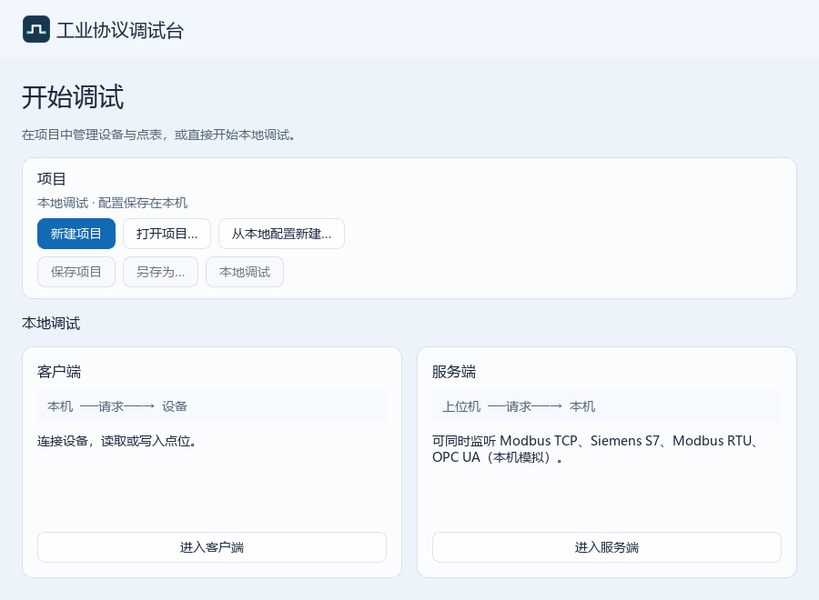
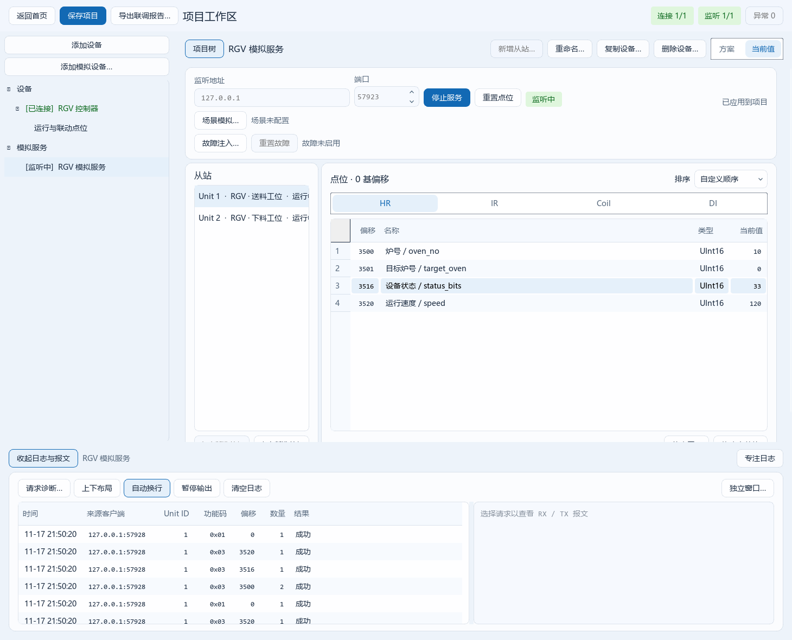
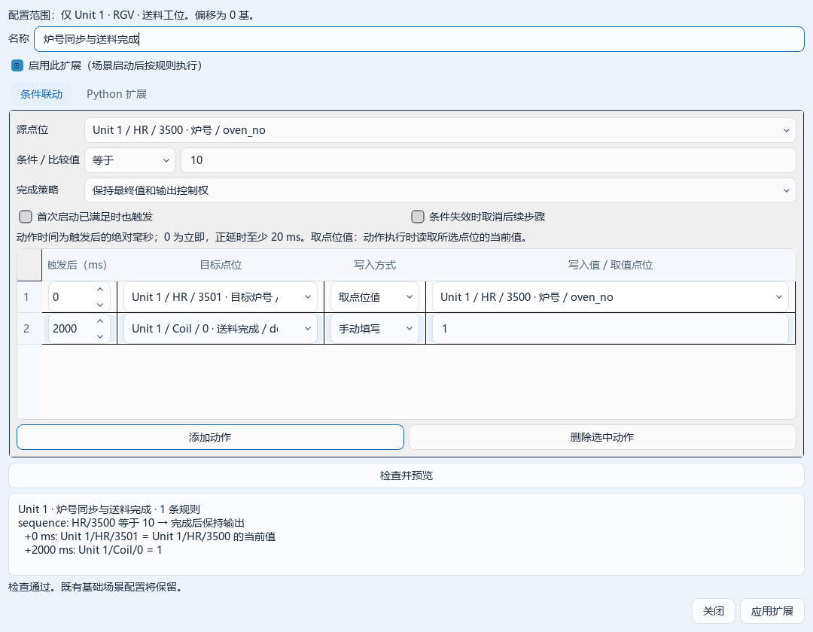
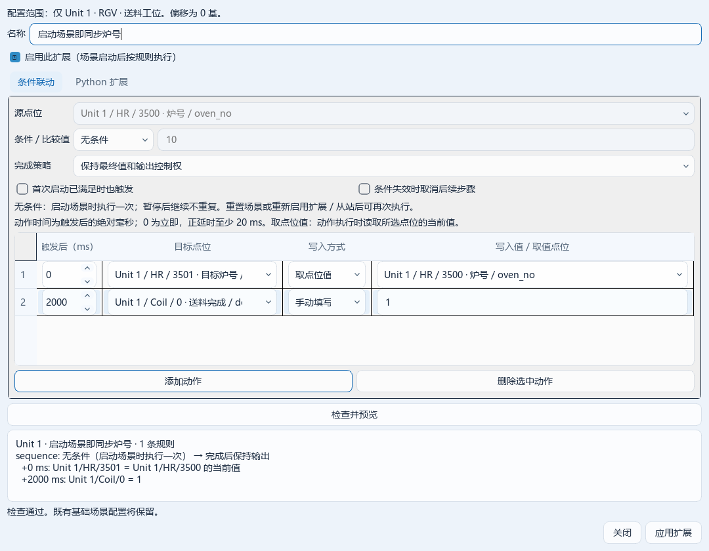
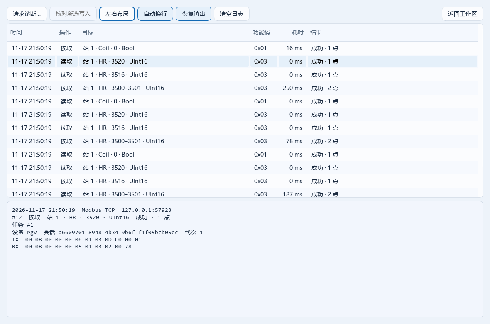

# AllProtocol · 工业协议调试台

[](https://github.com/GTboy04/all-protocol/stargazers)
[](LICENSE)
[](pyproject.toml)


面向 PLC、上位机和工业设备联调的 Windows 桌面工具。在同一个项目工作区中连接设备、启动模拟服务、监视点表、配置点位联动，并查看请求的 TX / RX 报文。设备、点表、Bit 含义和模拟规则随项目保存，方便重复联调与交接。

支持 **Modbus TCP、Siemens S7、Modbus RTU 和 OPC UA**。Modbus RTU、OPC UA 目前为预览功能，具体验收范围见下方协议表。

[快速开始](#快速开始) · [协议支持](#协议支持) · [服务端控制](#服务端与从站控制) · [场景联动](#场景联动与点位取值) · [日志与诊断](#日志报文与诊断) · [使用指南](docs/user-guide.md)


本文截图于 **2026-11-17** 从当前源码生成，使用本机 Modbus TCP 模拟服务和示例点位；图中端口为临时端口。

## 快速开始

安装 Git 和 [uv](https://docs.astral.sh/uv/getting-started/installation/)，在 Windows PowerShell 运行：

```powershell
git clone https://github.com/GTboy04/all-protocol.git
cd all-protocol
uv python install 3.12
uv sync --locked --python 3.12
uv run --locked python -m all_protocol
```

首页提供「本地调试」和项目入口。临时读写可直接进入客户端或服务端；需要保存设备、点表和模拟规则时，新建项目并进入项目工作区。



Windows 可执行文件构建方式见[打包指南](docs/user-guide.md#打包-windows-应用)。运行打包版时须完整解压，保留程序旁的 `_internal` 目录。

## 协议支持

| 协议 | 客户端与模拟服务能力 | 验证范围 |
| --- | --- | --- |
| Modbus TCP | Unit ID 多从站；HR、IR、Coil、DI；16 / 32 / 64 位寄存器类型、字节序和字序；点位读写与场景联动 | 本机真实 TCP 读写、多站隔离与桌面交互自动化 |
| Siemens S7 | 经典 S7comm / ISO-on-TCP；DB、M、I、Q 区；Bool、Byte、Int、Word、DInt、DWord、Real；I 区对网络客户端只读 | 本机协议互通和独立客户端测试 |
| Modbus RTU（预览） | Windows COM 串口；站号 1–247；默认 9600 / 8E1；多站模拟、CRC 诊断、写入回读 | 软件和串口链路模拟测试；实机串口验收待完成 |
| OPC UA（预览） | 端点发现、节点浏览、标量读写、订阅；Basic256Sha256 / SignAndEncrypt 与证书信任；本机模拟 | 软件及独立客户端互通；独立厂商设备验收待完成 |

自动重连可按设备配置，默认关闭；可选择恢复读取轮询和订阅。写入结果未知或尚未执行的手动请求不会自动重放。现场互通与连续 24 小时稳定性仍需按实际环境验收。

## 服务端与从站控制

项目最多可配置 **64 个模拟服务**，支持同协议多实例、复制及独立启停。各实例的点位、运行值、场景与日志独立。例如三台 S7 模拟设备可分别监听 `127.0.0.1:1102`、`:1103`、`:1104`。

Modbus TCP 同一服务下可配置多个 Unit ID，在从站列表中单独启动或停止，也可启动全部从站。停止某站后，该 Unit ID 返回异常 `0x0B`，其他站继续通信；单站启停保留当前值。全部从站停止后，监听仍保留，点击「停止服务」释放端口。

**服务运行时点击「重置点位」**，可将本服务全部点位恢复为配置初始值，包括未配置场景规则的点位。重置会停止场景、取消待执行动作并清除手动接管，服务监听和客户端连接继续保持。已停止从站的点位在下次启动该站时恢复。



从站支持复制，以及全部数据区点位的 JSON / CSV 导入导出。点位可在停止服务后拖动行号排序；Modbus TCP / RTU、S7 还支持按地址排序。详见[多设备模拟指南](docs/multi-device-simulation.md)。

## 场景联动与点位取值

各协议的基础场景支持固定值、递增、心跳、斜坡、正弦和时间轴。Modbus TCP 还可在「场景模拟…」中按 Unit ID 配置条件联动与 Python 扩展。

一条联动规则可以这样配置：

1. 选择源点位，例如 `HR / 3500 · 炉号`，设置条件「等于 10」。
2. 在触发后 `0 ms`，将 `HR / 3501 · 目标炉号` 的写入方式设为「取点位值」，选择源点位。动作执行时复制该点位的当前值。
3. 在触发后 `2000 ms`，将 `Coil / 0 · 送料完成` 的写入方式设为「手动填写」，写入 `1`。
4. 点击「检查并预览」和「应用扩展」，保存方案或项目，启动服务后再启动场景。



动作时间均为**相对触发时刻的绝对毫秒数**。取点位值支持当前从站内的其他点位；同一步会先读取所有来源，再批量写入目标。源点位缺失、类型不兼容或实际值越界时会报错并停用扩展。

条件规则默认在源值进入条件时触发；如果启动场景时源值已经满足，也希望立即执行，请勾选「首次启动已满足时也触发」。

不需要条件时，在条件下拉框选择 **「无条件」**。启动场景即执行一次；暂停后继续不会重复执行。重置场景或重新启用扩展、从站后，可再次执行。



Python SDK 使用 `Scene`、`Step`、`build(scene)` 定义序列，支持点位值复制和 `scene.always(...)`。代码只在检查阶段生成计划，运行期间由场景引擎调度。本机检查进程不是安全沙箱，只应检查可信代码；导入的 Python 扩展需要在本机重新检查并启用。

扩展默认保持最终输出，也可选择完成后释放给基础场景。手动或客户端写入会接管相关点位；停止从站会取消该站的未完成动作。完整行为、SDK 示例和导入导出见[场景扩展指南](docs/modbus-scenario-extensions.md)。

## 点表、功能描述与 Bit 查看

每台设备拥有独立会话和命名点表，支持批量连接、多组周期轮询、工程值换算及 JSON / CSV 导入。采样区分有效、超时、断开、协议失败和过期，失败时保留最后成功值并标记状态。

点位可保存多行功能描述和每个 Bit 的名称、0 / 1 含义，并按名称、地址、描述筛选或跨当前设备点表定位。停止采集后可拖动行号调整顺序。

「位查看…」支持负数补码和 IEEE 754 浮点数。**格子只显示 Bit 编号与当前值，点击后在下方显示名称、掩码和业务含义。** Bit 0 为解码后原始值的最低位；协议字节顺序以 TX / RX 报文为准。查看不会写入设备。


## 日志、报文与诊断

客户端和服务端日志均支持 **「暂停输出 / 恢复输出」**。暂停后列表、选择和报文详情保持，方便停下来阅读某条记录；通信和日志存储继续。恢复后显示最新保留日志。

日志区可调整分隔条、切换上下 / 左右布局与自动换行，也可放到可最大化的独立窗口。项目工作区使用「专注日志」或 `Ctrl+Shift+L` 展开阅读。



「清空日志」同步清理对应本地历史、列表和详情，通信继续，新请求继续记录。项目中按当前设备或模拟服务端点清理。

| 工具 | 用途 |
| --- | --- |
| 请求诊断 | 筛选请求，查看失败率、平均耗时、P50 / P95，定位协议字段与原始字节 |
| 故障注入 | 模拟延迟、异常应答或断开，限定操作类型、次数或持续时间 |
| 写入回读 | 设备应答后按延迟回读，设置浮点容差；也可独立核对所选写入 |
| 联调报告 | 冻结配置与日志后预览，导出包含离线 HTML、JSON、CSV 的 ZIP，保留写入验证与日志缺失信息 |

## 项目与数据保存

`.allprotocol` 项目使用 SQLite 保存设备、点表、模拟方案和工作区布局，可复制到其他电脑。连接状态、当前采样值和运行任务不随项目恢复；日志按本地保留策略存储。报告用于交付需要保留的联调记录。

本版可读取旧 JSON 和 SQLite 项目。包含固定值场景扩展的配置使用方案 v5 / 项目 v9；使用点位取值或无条件规则时升级为方案 v6 / 项目 v10，扩展导出包使用 v2。旧版程序无法读取超出其支持版本的配置，交接时请使用匹配版本，或另存副本保留原件。

本地配置和日志位于 `%LOCALAPPDATA%\AllProtocol\allprotocol.sqlite3`。每个日志来源显示最近 500 条，按 5 MiB 日志内容阈值轮换。退出程序后复制数据库可备份；旧 JSON / JSONL 首次访问时自动迁移并保留原件。OPC UA 证书和私钥路径属于本机配置，换机后需重新设置。

## 本机联调示例

1. 在 Modbus TCP 服务端新增 Unit 1，添加偏移为 0、类型为 UInt16、初始值为 42 的 HR 点位。
2. 启动服务，客户端连接 `127.0.0.1:1502`，读取 Unit 1 / HR / 0，结果应为 42。
3. 写入 100 后回读；在日志中检查 TX / RX。点击「暂停输出」即可固定当前阅读位置。
4. 服务端点击「重置点位」，使用同一客户端连接再次读取，结果恢复为 42。
5. 需要自动变化时，停止服务后配置基础场景或联动规则，保存后重新启动服务与场景。

S7 本机模拟默认使用 `127.0.0.1:1102`、Rack 0 / Slot 1。OPC UA 模拟仅支持回环地址，需要显式选择无加密匿名模拟模式。RTU 客户端和模拟端需要相互连通的两个可用串口，不能占用同一 COM 端口。

## 开发与验证

```powershell
uv sync --locked --group dev
uv run --locked pytest tests/unit tests/integration -q
```

2026-11-17 当前源码全量回归：**538 项通过、3 项跳过**。覆盖协议读写、从站控制、场景时序与复制取值、存储往返、日志暂停及桌面交互。自动化结果不替代真实设备、打包版现场互通和长时间稳定性验收。

功能开发使用 `codex/` 前缀分支，验证后通过合并提交纳入 `main`。本次新增功能集中在 `codex/modbus-scenario-extensions`，保留功能提交与合并记录。

## 文档与贡献

- [使用指南](docs/user-guide.md)：客户端、服务端、项目、打包与操作说明。
- [场景扩展指南](docs/modbus-scenario-extensions.md)：表单、Python SDK、运行行为及文件兼容性。
- [场景扩展交付记录](docs/requirements/R21-scenario-extensions.md)：实现范围、验证和边界。
- [多设备模拟](docs/multi-device-simulation.md)、[SQLite 存储](docs/sqlite-storage.md)。
- [Modbus RTU](docs/r11-modbus-rtu.md)、[OPC UA](docs/r12-opc-ua.md)、[运行恢复](docs/r13-runtime-reliability.md)。
- [开发路线与需求记录](docs/requirements/README.md)。

欢迎通过 [Issues](https://github.com/GTboy04/all-protocol/issues) 报告问题，或提交 Pull Request。问题报告请包含协议、复现步骤及脱敏报文。本项目采用 [MIT 许可证](LICENSE)。

## Star 趋势

<a href="https://www.star-history.com/?repos=GTboy04%2Fall-protocol&amp;type=Date">
  <picture>
    <source media="(prefers-color-scheme: dark)" srcset="https://api.star-history.com/svg?repos=GTboy04/all-protocol&amp;type=Date&amp;theme=dark">
    <source media="(prefers-color-scheme: light)" srcset="https://api.star-history.com/svg?repos=GTboy04/all-protocol&amp;type=Date">
    
  </picture>
</a>

## 许可证

本项目采用 [MIT 许可证](LICENSE)。
