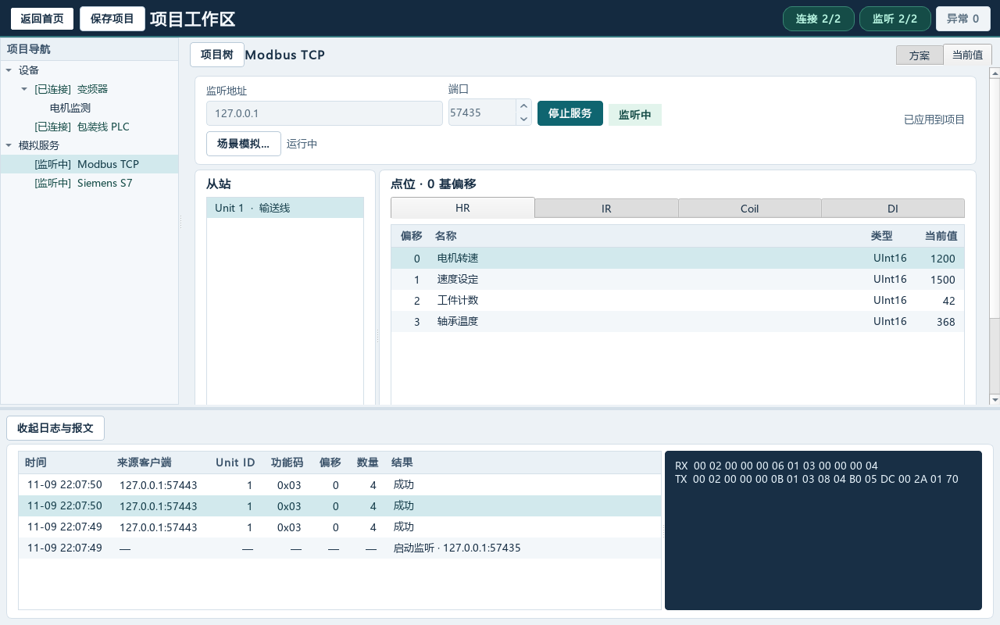
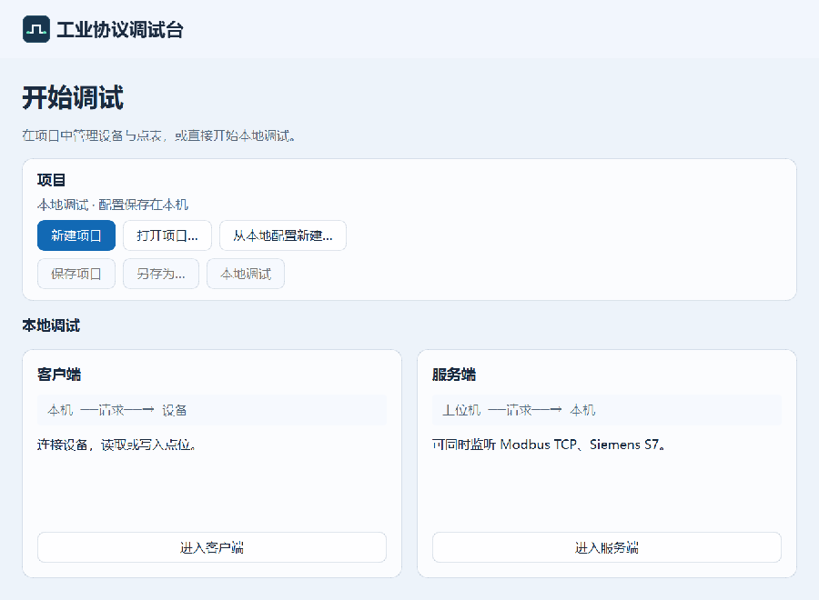
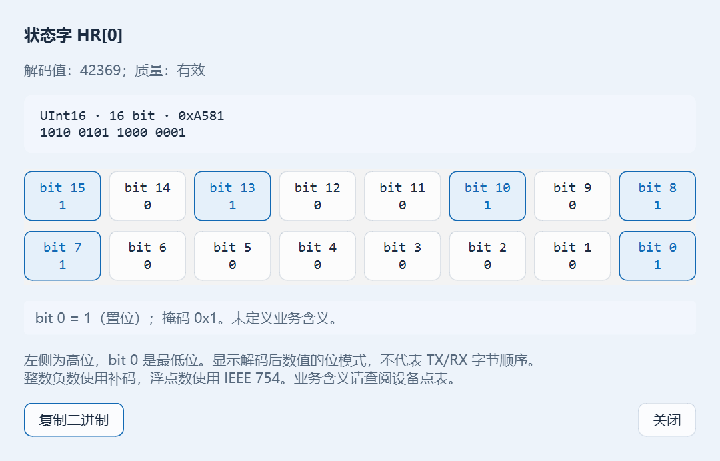

# AllProtocol · 工业协议调试台

[](https://github.com/GTboy04/all-protocol/stargazers)
[](LICENSE)
[](pyproject.toml)


面向 PLC 和工业设备联调的 Windows 桌面工具。通过同一个工作区连接真实设备、启动模拟服务、监视点位并查看原始报文。支持 **Modbus TCP** 和 **Siemens S7（经典 S7comm / ISO-on-TCP）**，两个协议均可作为客户端和服务端运行。

[界面与位查看](#界面与位查看) · [快速开始](#快速开始) · [本机联调](#本机联调) · [使用指南](docs/user-guide.md) · [参与贡献](#参与贡献) · [Star 趋势](#star-趋势)



## 功能概览

| 能力 | 支持范围 |
| --- | --- |
| Modbus TCP | 按 Unit ID 访问 HR、IR、Coil 和 DI。支持 16、32、64 位寄存器类型及多种字节序和字序 |
| Siemens S7 | 访问 DB、M、I、Q 区，支持 Bool、Byte、Int、Word、DInt、DWord 和 Real。I 区对网络客户端只读 |
| 多设备与点表 | 独立连接和轮询多台设备，使用命名点表查看原始值、工程值和采样质量，支持 JSON 和 CSV 导入 |
| 服务端场景 | 两个协议可同时监听。点位支持固定值、递增、心跳、斜坡、正弦和时间轴，可暂停、重置或手动接管 |
| 项目与报文 | 保存设备、点表和服务端方案到可移植的项目文件，联调时查看请求结果及 TX / RX 十六进制报文 |
| 二进制与位查看 | 查看 Bool 及 8、16、32、64 位数值的位模式，支持负数补码和 IEEE 754 浮点数；逐位查看为只读操作 |
| Windows 界面 | 跟随系统浅色、深色主题，支持键盘快捷键；受支持的 Windows 11 环境启用 Acrylic 背景，高对比度模式回退原生配色 |

## 界面与位查看

从首页进入本地客户端、服务端或项目工作区。窗口保留系统标题栏，主题跟随系统设置；不支持 Acrylic 的环境使用普通背景。



在读取结果、项目点表或服务端点位中选择一行，点击「位查看…」，查看每个 bit 的值、掩码和浮点字段。窗口随所选点位和数值更新，并显示断开、过期等采样状态。这里展示解码后数值的位模式，bit 0 为最低位，协议字节顺序仍以 TX / RX 报文为准；位查看不会写入设备。



## 快速开始

在 Windows 上安装 Git 和 [uv](https://docs.astral.sh/uv/getting-started/installation/)，然后在 PowerShell 运行。

```powershell
git clone https://github.com/GTboy04/all-protocol.git
cd all-protocol
uv python install 3.12
uv sync --locked --python 3.12
uv run --locked python -m all_protocol
```

临时联调可从首页进入「本地调试」。需要保存设备、点表与模拟规则时，选择「新建项目」并进入项目工作区。构建 Windows 可执行文件的命令见 [Windows 打包指南](docs/user-guide.md#打包-windows-应用)。

## 本机联调

1. 在服务端选择 **Modbus TCP**，新增 Unit ID 为 `1` 的从站，并添加一个偏移为 `0`、类型为 UInt16 的 HR 点位。
2. 如需动态值，在启动监听前打开「场景模拟…」，为该点配置斜坡或周期递增。点击「启动服务」，再从「场景模拟…」启动场景。
3. 在 Modbus TCP 客户端连接 `127.0.0.1:1502`，读取同一个点位。可在请求日志中选中一条记录，查看对应的 TX / RX 报文。

也可以启动 **Siemens S7** 服务，用客户端连接 `127.0.0.1:1102`（Rack 0 / Slot 1），读取预置点位 `DB1.DBW0`。

## 文档

- [使用指南](docs/user-guide.md)涵盖源码运行、Windows 打包、项目文件、客户端与服务端配置。
- [Windows UI 设计](docs/windows-ui-design.md)记录界面改造依据、开源参考、主题与键盘交互及预览。
- [开发路线](docs/requirements/README.md)记录功能状态和验收范围。
- [协议扩展开发路线](docs/requirements/protocol-expansion.md)记录 Modbus RTU、OPC UA 及后续候选协议的实施与验收计划。
- [Modbus TCP 服务端设计](docs/modbus-tcp-server-design.md)、[Siemens S7 客户端设计](docs/s7-client-design.md)和[场景模拟](docs/requirements/R7-simulation.md)提供协议和运行细节。

## 参与贡献

欢迎通过 [GitHub Issues](https://github.com/GTboy04/all-protocol/issues) 报告问题或提出功能建议，也欢迎提交 Pull Request。报告联调问题时，请附上协议、复现步骤和脱敏后的报文。

提交改动前可运行以下命令验证。测试使用本机临时端口，覆盖协议读写、模拟场景、项目存储和桌面交互。

```powershell
uv run --locked pytest -q
```

Windows 桌面测试若因跨测试窗口回收导致 Qt 原生进程退出，可按测试文件分别运行。弹窗文字更新与清空的回归检查可单独执行：

```powershell
uv run --locked pytest tests/integration/test_dialog_repainting.py -q
```

## Star 趋势

<a href="https://www.star-history.com/?repos=GTboy04%2Fall-protocol&amp;type=Date">
  <picture>
    <source media="(prefers-color-scheme: dark)" srcset="https://api.star-history.com/svg?repos=GTboy04/all-protocol&amp;type=Date&amp;theme=dark">
    <source media="(prefers-color-scheme: light)" srcset="https://api.star-history.com/svg?repos=GTboy04/all-protocol&amp;type=Date">
    
  </picture>
</a>

## 许可证

本项目采用 [MIT 许可证](LICENSE)。
