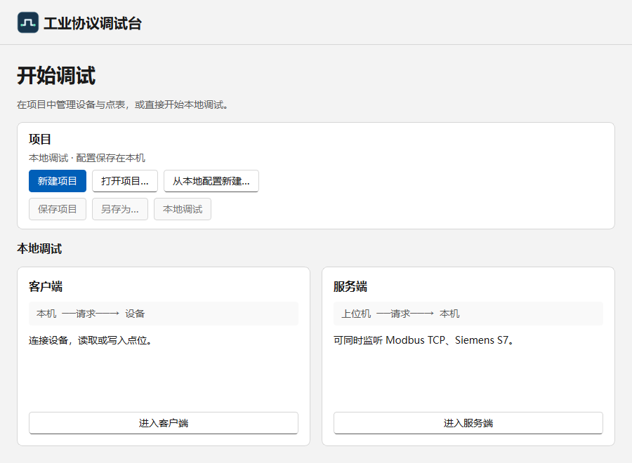
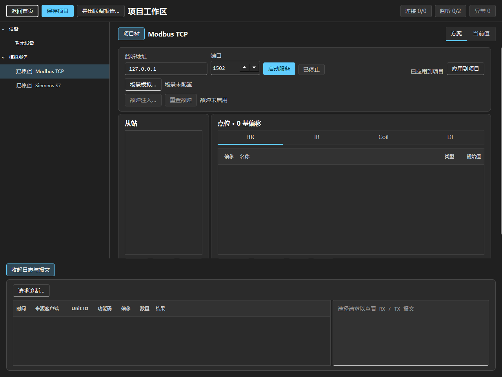
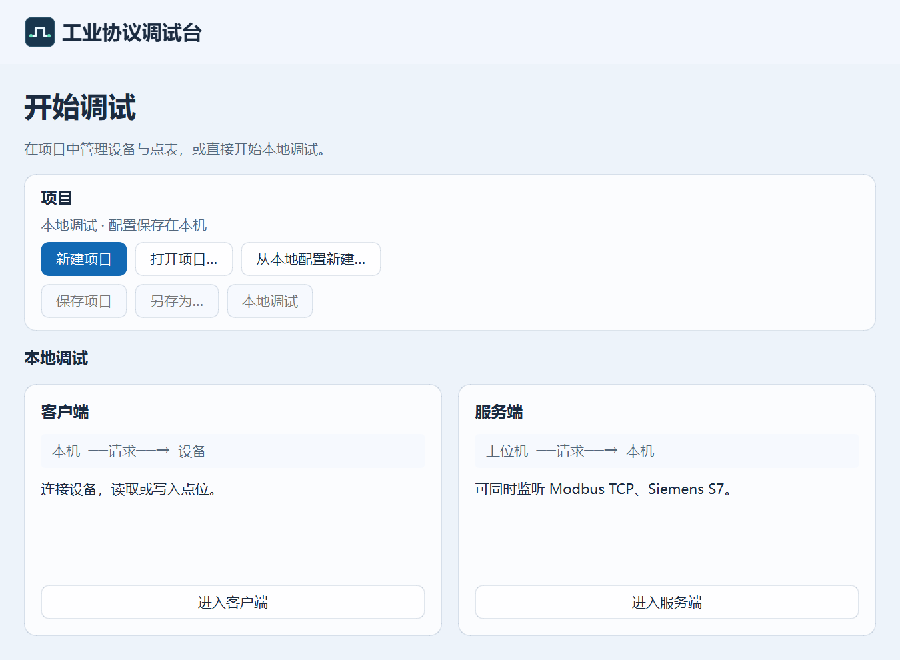
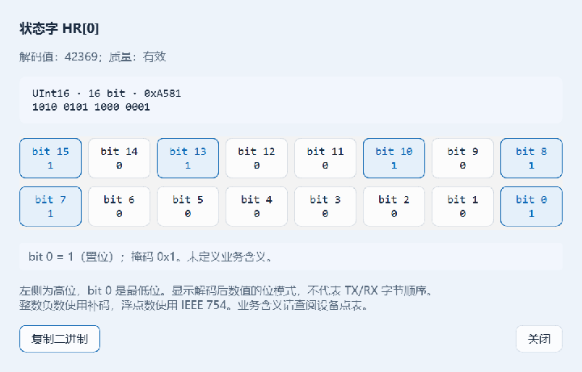

# Windows 桌面 UI 改造

本次调整 UI、键盘交互与数值位模式查看，不新增协议，不修改协议读写、模拟、项目文件格式。

## 设计依据与开源参考

查阅日期：2026-11-11。

| 来源 | 在本项目中的应用 |
| --- | --- |
| [Microsoft Windows 设计基础](https://learn.microsoft.com/en-us/windows/apps/design/basics/) | 区分导航、操作和内容；保留系统窗口边框、标题栏与最大化行为。 |
| [Windows 字体规范](https://learn.microsoft.com/en-us/windows/apps/design/signature-experiences/typography) | 建立正文、分区标题、页面标题的层级。中文优先 Microsoft YaHei UI，后备 Segoe UI Variable Text / Segoe UI，报文使用 Consolas。 |
| [布局、有效像素与缩放](https://learn.microsoft.com/en-us/windows/apps/design/layout/screen-sizes-and-breakpoints-for-responsive-design) | 使用 Qt 逻辑像素，以 4 的倍数组织主要间距；按钮间距 8，面板内边距 16，首页外边距 24。 |
| [键盘无障碍](https://learn.microsoft.com/en-us/windows/apps/design/accessibility/keyboard-accessibility) | 保留 Tab 顺序、可见焦点、原生控件键盘行为，并补充项目快捷键。 |
| [WinUI Gallery](https://github.com/microsoft/WinUI-Gallery) 及其 [ControlExample](https://github.com/microsoft/WinUI-Gallery/blob/main/WinUIGallery/Controls/ControlExample.xaml) | 参考微软示例的内容分区、控件层级、导航与自适应方式。 |
| [PyQt-Fluent-Widgets](https://github.com/zhiyiYo/PyQt-Fluent-Widgets) | 调研 Qt 中的 Fluent 控件形态和交互状态。仅参考设计，未复制源码或加入依赖；其 GPL/商业授权与本项目 MIT 许可不同。 |
| [Qt QStyleHints](https://doc.qt.io/qtforpython-6/PySide6/QtGui/QStyleHints.html) | 跟随系统配色变化，在系统调色板更新后刷新界面；Qt 6.10 及以上通过 accessibility hints 响应高对比度偏好。 |
| [DWM 系统背景类型](https://learn.microsoft.com/en-us/windows/win32/api/dwmapi/ne-dwmapi-dwm_systembackdrop_type) | Windows 11 22621 及以上通过系统 Desktop Acrylic 实现真实毛玻璃；保留原生标题栏。 |
| [Qt 控件样式表参考](https://doc.qt.io/qt-6/stylesheet-reference.html) | 定制数字输入框独立的圆角上下箭头，明确大小、间距和点击区域。 |

这是现有 PySide6 Widgets 应用的 Fluent 风格改造，并非迁移为 WinUI 3，也不表示已通过微软无障碍认证。窗口使用系统标题栏与系统背景材质。

## 实现

- Windows 优先使用 Qt 的 windows11 样式，其次 windowsvista / Windows；其他平台回退 Fusion。
- 浅色使用 `#edf3fa` 背景、半透明白色内容面和 `#1269b4` 强调色；深色使用 `#202631` 背景、半透明蓝灰色内容面和 `#80cfff` 强调色。按钮使用 8px 圆角和轻描边，去除原有明显底线；面板圆角为 12px。
- Windows 11 支持时启用 Acrylic，系统按透明效果偏好、窗口激活状态决定最终呈现。接口不可用时保留有色背景和半透明控件，不模拟桌面模糊。不对文字或整个窗口使用模糊滤镜。
- 主题规则集中于 `src/all_protocol/ui/style.py`，随系统主题和调色板变化刷新。Qt 仍拥有系统调色板，菜单、复选框等保留原生控件行为。
- 透明背景启用后显式恢复 Qt 背景清除，避免地址、错误提示等动态标签局部重绘时残留旧字形；关闭 Acrylic、系统不支持或 DWM 调用失败时也恢复该状态。
- 高对比度偏好启用时清除自定义样式，让原生调色板接管；Qt 6.8/6.9 无此偏好 API，仍可正常运行，但不提供这项自动回退。
- 首页按项目操作、本地客户端、本地服务端组织；主要操作使用蓝色，其他操作使用中性色。
- 首页使用滚动容器，小窗口下仍可通过 Tab 到达底部入口；项目原有可伸缩导航、日志和内容滚动机制保留。
- 客户端、服务端、项目导航、对话框统一标题、面板、表格行高、页签、禁用态与焦点状态。连接状态保留文字，并辅以主题相关颜色。
- 首页支持 Ctrl+N 新建、Ctrl+O 打开、Ctrl+S 保存、Ctrl+Shift+S 另存为；项目工作区支持 Ctrl+S 保存。快捷键跟随相应按钮的启用状态。

## 验证与边界

运行 `uv run --locked pytest -q` 验证原有功能。新增 `tests/integration/test_windows_ui.py` 覆盖首页小窗口布局、Tab 到达底部入口、Ctrl+N、有效主题配色、禁用按钮及模拟高对比度偏好。

`tests/integration/test_dialog_repainting.py` 在独立进程中检查背景启用、关闭及失败回退；受支持的 Windows 环境还直接读取原生窗口像素，覆盖浅色、深色下地址连续切换、清空和错误提示更新，避免完整重绘掩盖局部更新时的文字残留。

本次按测试文件隔离进程验证，共 **273 项通过**（28 个测试文件）。整套在单一进程运行时仍出现 Qt 跨测试窗口回收退出，因此不将它记为单进程全量通过。主题测试独立初始化 QApplication，覆盖数字箭头点击/键盘行为、bit 状态刷新、旧数据质量与清空选择。S7 断开重连测试等待连接进入最终离线状态，避免在线数量提前变化时误判仍在关闭的连接。

使用 Windows 原生 Qt 平台实际渲染检查首页、客户端与服务端的浅色/深色界面，检查 640×480 小窗口及 100%、125%、150% 缩放布局。测试中的 offscreen 平台可能不响应系统主题覆盖，因此测试依据有效主题判断；它不能替代真实 Windows 辅助技术和多显示器 DPI 验收。

预览图：

## 二进制与逐位查看

- 快速读写结果和项目点表追加「二进制」列，每 4 位分组。
- 选择一行点击「位查看…」，打开只读窗口。Modbus 和 S7 服务端点位也提供此入口：服务停止时查看配置初始值，运行时查看当前值。
- 位窗口跟随所选点位、采样值及质量更新。每格显示 bit 编号和 0/1；点击显示掩码和置位/清零状态。位查看不向设备写入。
- bit 0 是最低位。数值根据读取配置完成字节序/字序解码后，再展示数值位模式，与 TX/RX 字节在报文中的排列不同。原十六进制响应内容仍保留。
- 保留 Bool、8、16、32、64 位宽。负数显示补码；Float32/Real 与 Float64 使用相应 IEEE 754 编码，可区分符号、指数、尾数字段。NaN/无穷值不从解码值推测原始载荷位。
- 旧采样数据保留断开、过期等质量说明；无值或未选择时清空 bit 格子。64 位视图可滚动，避免在缩放屏幕上遮住关闭按钮。
- 「置位/清零」仅表示数值状态；运行、报警、故障等设备业务含义仍需设备点表定义。

